<!-- Generated by scripts/build.py from profile.yml. Do not edit by hand. -->

<picture><source media="(prefers-color-scheme: dark)" srcset="assets/dark/banner.svg">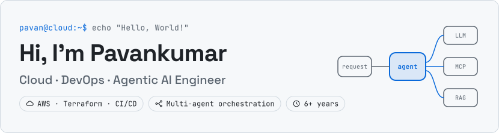</picture>

I'm a cloud and DevOps engineer who builds agentic AI systems. I design the infrastructure, pipelines and orchestration that take LLM workflows from prototype to production on AWS.

Most recently at DeepSense (Dalhousie University), where I designed and shipped a multi-agent platform on Amazon Bedrock. Before that, cloud engineering for a multi-tenant SaaS platform. Master of Digital Innovation, Dalhousie.

<picture><source media="(prefers-color-scheme: dark)" srcset="assets/dark/h-focus.svg"></picture>

<picture><source media="(prefers-color-scheme: dark)" srcset="assets/dark/focus.svg">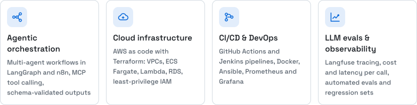</picture>

<picture><source media="(prefers-color-scheme: dark)" srcset="assets/dark/h-work.svg"></picture>

<picture><source media="(prefers-color-scheme: dark)" srcset="assets/dark/work-1.svg">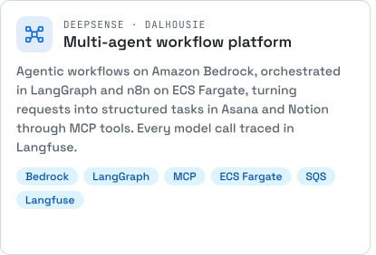</picture><a href="https://github.com/pms07/aws-sagemaker-llm"><picture><source media="(prefers-color-scheme: dark)" srcset="assets/dark/work-2.svg">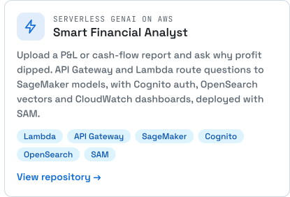</picture></a>

<a href="https://github.com/pms07/AI-Assisted-Post-Surgery-Reporting"><picture><source media="(prefers-color-scheme: dark)" srcset="assets/dark/work-3.svg">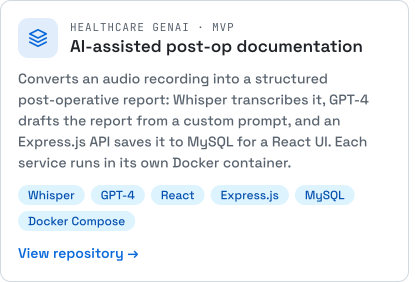</picture></a><a href="https://pms07.github.io/ai-agent-handbook/"><picture><source media="(prefers-color-scheme: dark)" srcset="assets/dark/work-4.svg">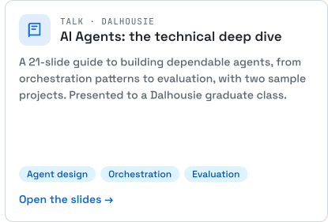</picture></a>

<picture><source media="(prefers-color-scheme: dark)" srcset="assets/dark/h-tools.svg"></picture>

<picture><source media="(prefers-color-scheme: dark)" srcset="assets/dark/tools-cloud.svg">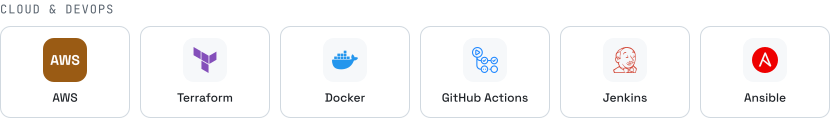</picture>

<picture><source media="(prefers-color-scheme: dark)" srcset="assets/dark/tools-ai.svg">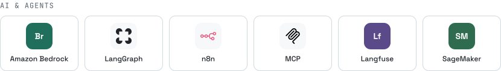</picture>

<picture><source media="(prefers-color-scheme: dark)" srcset="assets/dark/tools-build.svg">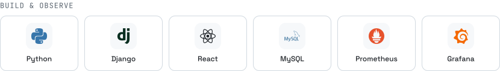</picture>

<picture><source media="(prefers-color-scheme: dark)" srcset="assets/dark/h-hack.svg"></picture>

<a href="https://github.com/pms07/coastal-health"><picture><source media="(prefers-color-scheme: dark)" srcset="assets/dark/hack-1.svg">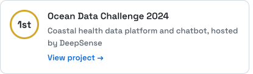</picture></a><picture><source media="(prefers-color-scheme: dark)" srcset="assets/dark/hack-2.svg">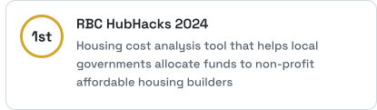</picture>

<a href="https://github.com/pms07/datajam"><picture><source media="(prefers-color-scheme: dark)" srcset="assets/dark/hack-3.svg">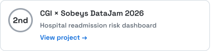</picture></a><a href="https://github.com/pms07/Covid19-Info-fact-checker-ai-agent"><picture><source media="(prefers-color-scheme: dark)" srcset="assets/dark/hack-4.svg">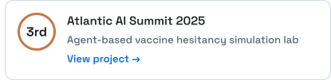</picture></a>

<picture><source media="(prefers-color-scheme: dark)" srcset="assets/dark/h-contact.svg"></picture>

<a href="https://linkedin.com/in/pms07"><picture><source media="(prefers-color-scheme: dark)" srcset="assets/dark/linkedin.svg"></picture></a><picture><source media="(prefers-color-scheme: dark)" srcset="assets/dark/status.svg"></picture>

